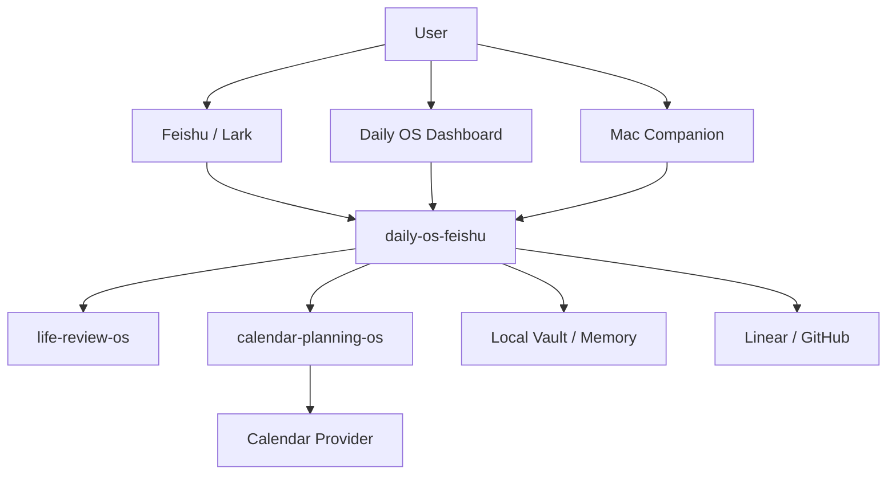

# Daily OS

Daily OS is a local-first personal operating layer for planning, review, and AI-assisted execution.

This repository is the umbrella map. It does not contain the product runtime. Use it to understand which project does what, where to start, and what is optional.

## Start Here

For the current alpha, start with:

| Project | Role | Status |
| --- | --- | --- |
| [daily-os-feishu](https://github.com/alexli-77/daily-os-feishu) | Main local app: Feishu commands, dashboard, scheduler, Mac companion, daily todo/review | `v0.1.0-alpha.2` |
| [life-review-os](https://github.com/alexli-77/life-review-os) | Weekly / biweekly / quarterly review skill and CLI | Active |
| calendar-planning-os | Calendar draft and time-block planning engine | Planned |

## Architecture

## Design Principle

Daily OS should keep the user in control.

- Plans are drafts before they become commitments.
- Calendar writes require confirmation.
- Personal memory and config stay local.
- Optional engines should be installable without making the main app fragile.

## Repositories

### daily-os-feishu

The main entry point for the current alpha.

It handles:

- Feishu commands and message cards
- Daily plan and daily review
- Weekly review command routing
- Dashboard setup and local config
- Decision policy editing
- Daily todo inbox
- Mac companion prototype
- `launchd` service install

### life-review-os

The deeper review engine.

It handles:

- Weekly review
- Biweekly review
- Quarterly review
- Feishu Weekly document read/write
- Review skill instructions and CLI

### calendar-planning-os

Planned optional engine.

It should handle:

- Weekly calendar drafts
- Daily calendar adjustments
- Time-block planning
- Calendar policy and energy preferences
- Conflict checks
- Confirmed write-back to calendar providers

Daily OS should call it as a service or CLI. It should not be tightly embedded in `daily-os-feishu`.

## Current Release

Current alpha: [daily-os-feishu v0.1.0-alpha.2](https://github.com/alexli-77/daily-os-feishu/releases/tag/v0.1.0-alpha.2)

## Next

See [docs/roadmap.md](docs/roadmap.md).
